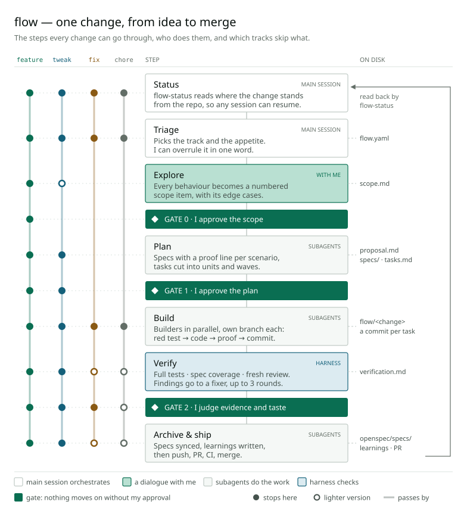

Hey again!

I am glad I keep finding different and interesting things to deal with and
write about. Today's topic is what I learned about AI workflows: the issues you
run into when working with AI, how other people and companies approach them,
and finally how I integrate AI into my own work.

## Something worth deploying

As I mentioned in my first post, I am currently working in DevOps, and that is
also what I want to focus on for the time being. Firstly, because I want to
build real expertise in one field rather than being mediocre in many, and
secondly, because I happen to have fun with it — though not always.

So now I would like to build my own CI/CD pipeline, tinker around with Proxmox,
provision my own machines and so on. But then a pretty blatant issue arises: I
have nothing in particular to deploy or to serve. I am very well aware that
there are project ideas and courses that walk you through the concepts and the
tools without you needing a full-fledged deployable app. But I wanted to build
and deploy something that means something to me, so I know I would stick with
it and maintain it — which also makes the whole process a lot more satisfying.

## Vibe coding, and why it wasn't enough

So off I went to Claude and tried to vibe code things I would actually use on a
regular basis: a dashboard where I can plan my weeks, for example, or an app
for the party games I play with my friends. I had nothing more than a dream and
a bit of hope, and not a lick of understanding of software engineering as a
discipline. As you might expect, all of those projects turned out mediocre at
best. Things were "done", but flaky and not up to the standard I wanted.

Now I had a little dilemma on my hands. Should I pause my investment in DevOps
and study software development instead? AI is great, but it still requires a
fundamental understanding of the task at hand to work efficiently and to
produce high-quality output. At the same time, I keep seeing and hearing how
much software development is changing, and pretty fundamentally too. So if I
were to spend that time, would it be time well spent?

In the end, I decided to research how different companies and people use AI to
improve the efficiency and quality of their work, rather than digging into a
whole new field — also in the hope of finding a little shortcut.

## Where I looked

Two sources ended up shaping everything that follows, plus one tool I built
on.

### AI-DLC

The first was the
[AI-Driven Development Lifecycle](https://prod.d13rzhkk8cj2z0.amplifyapp.com/),
a method definition by Raja SP at AWS. Its central idea is to reverse the
direction of the conversation. Instead of a human asking the AI to complete
tasks, the AI drives: it breaks a high-level intent down into units of work,
proposes plans and trade-offs, and asks clarifying questions. Humans approve,
select and correct at the decision points. The paper's own analogy is Google
Maps: you set the destination, the system gives you the directions, and you
keep an eye on the route.

What the paper is also very clear about is who it is for: teams building
complex systems, typically in large organisations, with a product owner,
developers and QA sitting in one room for rituals like "Mob Elaboration".

I am not a team. I tried it anyway, and this very site was built with it.

### Minimum Viable Harness

The second source was Raihan Alam's talk
[Minimum Viable Harness](https://ra1han.github.io/minimum-viable-harness/talks/introduction-deck.html).
Where AI-DLC is about process, this one is about the machinery around an agent.
It starts from failure modes I recognised immediately from my vibe coding days:

- feedback loops that keep getting longer,
- false "done": the agent says it's finished, and then it doesn't actually run,
- session amnesia: whatever was learned disappears with the session,
- agents that can't reliably even start an unfamiliar repository.

Its answer is a harness built from three primitives: **sensors** that produce
deterministic evidence, **gates** that make checks mandatory at fixed points,
and **backpressure** that blocks progress until the proof exists. The motto:
*Move fast. Bring proof.*

### OpenSpec

The third piece is a tool rather than an idea.
[OpenSpec](https://github.com/Fission-AI/OpenSpec) is a small tool for
spec-driven development: before any code is written, a change gets a proposal,
specs with concrete scenarios and a task list, and once it's done, its specs are
merged into a set of living specs that describe what the app actually does. It
already did the middle part — from idea to plan — well, so instead of replacing
it, I wrapped my workflow around it.

## What I took, and what I left behind

### From AI-DLC

Starting off with AI-DLC, there were a couple of great takeaways that improved
my workflow tremendously:

- **Exploring the intent first.** Capturing, exploring and breaking down an
  intent until it concretely defines both the end goal and the problem space.
  This saves iterations, and it brings up aspects you might not have considered
  otherwise.
- **Units of work.** Structuring the work into units and handing them off to
  separate sessions or subagents. That keeps any single context from getting
  diluted, and every agent gets to be the "expert" for its one task.
- **Artifacts as memory.** Persisting the plan and the decisions made along the
  way as artifacts, for later reference. That builds a sort of memory for the
  AI, and it makes working across sessions — or, in AI-DLC's case, across teams
  — a lot easier.
- **The AI works, the human steps in at specific points.** Instead of
  sprinkling my input and feedback throughout the whole session, I intervene at
  a few defined points. That way I can give concrete feedback and make
  well-founded decisions, and the AI has a concrete starting point to work from.

At the same time, I ran into two main issues with AI-DLC in my case: the
process is pretty costly in tokens, and it is very time-intensive. Even a rather
small project like this one — just a static blog site — took several days. In
this repository, it came to 33 stages, 14 role agents and 240 files (5.7 MB) of
artifacts, for 14 commits.

There are multiple reasons for that, which I tackled later in my own
adaptation. The biggest one is the sheer number of human interventions, at many
different points and for seemingly minor decisions too — in Mob Elaboration,
but in the other stages as well. When multiple teams with the required
expertise work on the different phases, it makes sense to be that granular. As
a solo dev, it is way too much.

### From the harness talk

This is where I realised that a harness — still a rather new and broad term —
and AI-DLC are intertwined. A lot of what AI-DLC does already is harness: the
artifacts, for example, are exactly what deals with the amnesia problem. Still,
there are a few things I took from the talk:

1. **Sensors as the source of truth.** Sensors decide whether an implementation
   is actually correct. For software development, that made me realise how
   important tests are, and looking at it now, I have mostly ended up with a
   test-driven way of developing with AI. That is a rabbit hole I still have to
   go down properly in the future.
2. **Enforced checks.** Fixed points where the checks are enforced, and progress
   is only allowed once they are green and the rules are met. Raihan Alam calls
   these gates. In my workflow I use that word a bit differently, for the few
   points where I step in, but the idea is the same.

In software development, those checks tie back beautifully to the human
interventions from the AI-DLC part. Among other things, they make sure the
intent I agreed to is actually being realised, so I no longer have to check
that myself, and the points where I step in can shrink to the decisions only I
can make.

All of this ended up in a Claude Code skill called `flow`.

## How flow works

Here is the whole thing on one page. Click the graphic for the full-size
version.

### Who does what

The session I talk to doesn't do the work itself. It only orchestrates. Every
unit of work — planning, building, verifying, fixing, shipping — runs in a
subagent that gets a written brief, so it starts with exactly the context it
needs and nothing else. The main session doesn't even read source code or
diffs. It reads short reports, merges branches and keeps track of where things
stand.

The one exception is exploring the scope. That stays a real conversation
between the AI and me, because what to build is my call.

### Tracks

Not every change deserves the full process, so every change starts with a
triage into one of four tracks:

- **feature** — everything new and bigger. It gets every step.
- **tweak** — a small piece of new behaviour in something that already exists.
  It gets a short explore and one combined gate for scope and plan.
- **fix** — restores behaviour that was intended. It starts with a test that
  reproduces the bug and fails, and has a single gate at the end.
- **chore** — no behaviour change: config, dependencies, a refactor. Build,
  check, and one question whether to ship it.

On top of that, a `live` flag marks anything that touches running
infrastructure, which with a homelab is a lot of things. Those steps never run
without my go, and a dry run is part of the evidence.

The triage line also carries an **appetite**, borrowed from Shape Up. It is not
an estimate of how long something will take, but a budget for how much time it
is worth. When the work outgrows it, the scope gets renegotiated instead of the
work just carrying on. And if I disagree with the triage, I overrule it in one
word.

### Three gates

I am asked at three points, and only there:

- **Gate 0 — scope.** Every behaviour the change needs is written down as a
  numbered item with its edge cases, together with what it explicitly won't do.
- **Gate 1 — plan.** I check that every scope item is covered by a unit of work,
  and that nothing was added I never asked for.
- **Gate 2 — evidence and taste.** Test results, the review findings and what
  happened to each, screenshots for me to judge, and one line saying exactly
  what approving will set off: push, pull request, merge. The approval is the
  consent to ship.

Everything between the gates goes to a sensor instead of to me.

### Proof

Every scenario in a spec ends with a **proof line** saying what will prove it:
`unit`, `e2e`, or `manual` with a reason. The test that proves a scenario has to
carry its name, so finding the evidence later is a lookup rather than a
judgement call.

What counts as proof isn't up to flow. Each repository declares its own check
commands in its `CLAUDE.md`: a fast one for typecheck, build and unit tests,
and a full one that adds the end-to-end tests. If a repository has none,
setting them up becomes the first unit of work. Builders write a scenario's test
first and watch it fail, then write the code, and commit only once the fast
check is green.

### Verification

Verification has three layers, run by agents that only find problems and never
fix them. Whoever writes the evidence shouldn't also be the one grading it.

1. **The full test suite.** Red goes to a fixer agent, not to me.
2. **Spec coverage.** For every scenario, the test named after it has to show up
   as *passed* in the output. A test that exists but never ran doesn't count.
3. **A fresh-context review.** An agent that knows nothing but the spec and the
   diff, with no summary from me, so it isn't primed by my reasoning. It looks
   for bugs, for behaviour no scenario covers and especially for weakened tests:
   a red test made green by changing what it expects.

Findings go to a fixer and the round starts again, at most three times. Whatever
is still open after that goes to Gate 2 as exactly that.

### State on disk

Everything flow knows lives in the repository, not in the session: the scope,
the specs, the task list with its ticked boxes, the branches, the verification
report, and a small `flow.yaml` with the decisions — track, appetite, gate
approvals. Every run starts with a script, `flow-status`, that reads all of it
back and works out where the change stands.

That is my answer to session amnesia. I can close the session, clear the
context or come back a week later, and the next run picks up exactly where the
last one stopped. When a change is done, its specs are merged into the living
specs, so they keep describing what the app actually does, and anything worth
remembering for next time is written down as a learning.

## Back to the dilemma

So, should I have paused DevOps to learn software engineering first?

Looking back at what made AI actually work for me, most of it isn't about
writing code at all. It's proof commands that have to pass before anything
counts, gates in front of anything irreversible, a pipeline that decides what is
allowed to ship, dry runs before touching a live system. That is pipeline
thinking, and pipeline thinking is DevOps.

That doesn't mean understanding stopped mattering. The AI still needs someone
who knows what is being built, and along the way I picked up more software
engineering than I expected: writing behaviour down as scenarios, walking edge
cases, knowing which tests are worth writing and which aren't. I just picked it
up through the harness rather than through a course.

And the problem I started with solved itself along the way. I now have a games
app and a dashboard I actually use, and a homelab that runs them. flow isn't
perfect, and I wouldn't be surprised if it looks a bit different a few posts
from now. But so far it does a good job, and it gets me where I wanted to go:
finally, something worth deploying.
