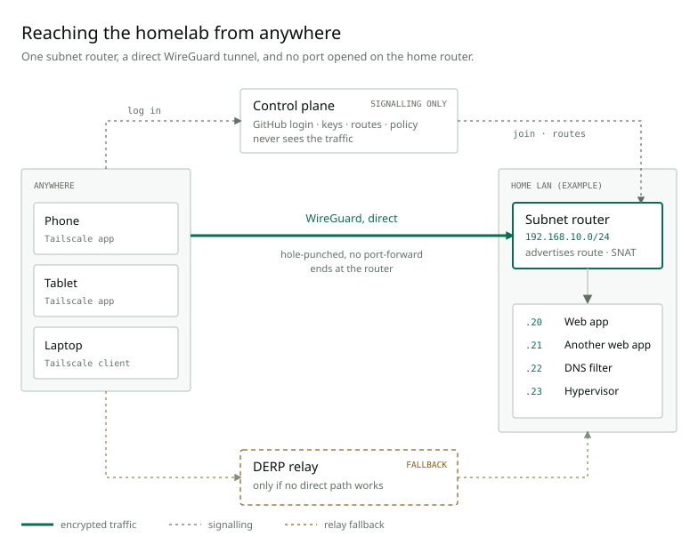

Here we go once again,

looks like I am able to keep up the streak, and I hope it stays that way. For
today's topic I want to talk about why and how I use Tailscale, and about the
different things I learned along the way, especially about VPNs. Like most of
y'all, I have heard from NordVPN, ExpressVPN and the other providers and their
very dumbed-down explanation of how a VPN works, and I also had classes on the
technical layers. Still, there were plenty of things I did not know until I
integrated a VPN service into my own homelab, and those are what I want to
share.

## The itch

There are services that I build myself and use regularly. Most of them are web
services, because I have different devices with different operating systems and
I would like to reach those apps from all of them without going through the
release and maintenance process of native apps. Web services are also fairly
simple to deploy through my CI/CD pipeline, and so far that works out neatly.

But I only host them on my homelab, which is reachable from within my home
network and nowhere else. That is on purpose: I do not want to deal with the
issues of a public-facing website with multiple users, such as security
concerns, availability, load balancing and so on. The flip side is the obvious
one, though. I cannot reach my own services from the outside. So the idea was to
establish a VPN tunnel between my devices and my home network, to securely
access the things running on my server.

## Tailscale versus a VPN provider

The word "VPN" covers two quite different things, and mixing them up was one of
the small gaps I had.

A commercial provider like NordVPN or ExpressVPN is built around **one
destination: the internet**. Your device builds a tunnel to the provider's
server, all of your traffic goes through it, and the server decrypts it and
sends it out to the internet from its own address. That hides your traffic from
the network you are on and your address from the websites you visit, and it
lets you appear to be in another country. What it does not do is connect you to
anything of yours.

Tailscale is built around the opposite idea: **a private network of your own
devices**. There is no central gateway your traffic has to pass through.

| | VPN provider | Tailscale |
| --- | --- | --- |
| Purpose | Privacy on untrusted networks, a different exit address, geo-unblocking | Reaching your own devices and networks from anywhere |
| Topology | Hub and spoke: every client connects to the provider's server | Mesh: devices connect directly to each other |
| Who sees the traffic | The provider's server decrypts it, so you trust the provider | Only the two endpoints, because the encryption is end-to-end between devices |
| Default routing | Full tunnel: all traffic goes through the VPN | Split tunnel: only traffic for tailnet addresses and advertised routes |
| Address you appear from | A shared address of the provider | Your normal one, unless you pick an exit node |
| Identity | Account and subscription, usually one login per client | A login through an identity provider, and a key pair per device |
| Behind NAT | The client dials out, the server has a public address | Every device dials out, and NAT traversal builds the direct path |
| What the servers do | Carry all of your traffic | Only coordinate keys, routes and policy |

The two are not strictly separate. Tailscale can also send all of your traffic
through one of your own devices, which is called an **exit node**, and that
behaves much like a provider's server except that you run it. I did not set one
up. A classic self-hosted VPN is a third variant: a server at home that listens
on a public port, which means a port forward on the router and a way to find a
home address that changes. Tailscale's answer to that last part is the reason
this setup needs no open port at all, and the next section explains how that
works.

## How Tailscale works

### Accounts, tailnets and nodes

Tailscale does not have accounts of its own. You sign in through an identity
provider, in my case GitHub, and that identity owns a **tailnet**: the private
network all my devices live in. Every device that joins is a **node** and gets
an address from the `100.64.0.0/10` range, which is reserved for exactly this
kind of thing. My phone, my tablet, my laptop and the subnet router (more on
that below) are all just nodes. None of them is special as far as the network is
concerned.

### Control plane and data plane

The part I had slightly wrong in my head is what the Tailscale servers actually
do. There are two separate things:

- The **control plane** is the coordination server. It knows who is in the
  tailnet, hands out each node's public key, distributes the policy and the
  routes, and tells nodes where to find each other. It never sees my traffic.
- The **data plane** is the traffic itself, and that runs on WireGuard between
  the nodes. Every node has its own key pair. The private key never leaves the
  device, the public key goes to the coordination server, and from there to
  every peer that needs it. When two nodes talk, they run a WireGuard handshake
  directly with each other and derive a fresh symmetric session key from it.

So "no server in between" is true for the data. What the servers know is who
exists and how to reach them.

### Getting through NAT

Two devices that both sit behind a NAT router cannot simply call each other:
a NAT only lets a packet in if some device behind it sent something out first.
Tailscale works around that with **hole punching**:

1. Each node sends a packet to a **STUN** server, which answers with the
   address the node looks like from the outside. That is the entry its NAT just
   created.
2. The nodes exchange those addresses through the coordination server.
3. Both send UDP packets to each other at the same time. The first one is
   dropped by the other side's NAT, but it leaves a mapping behind on the
   sender's own, so by the time the replies arrive they match an existing entry
   and get through.

After that the tunnel is direct. This is also why my router needs no port
forward: everything I own only ever talks outwards, and the NATs are tricked
into letting the answers in.

It does not always work. With strict or symmetric NAT, which is common on mobile
networks and in company networks, the external port differs per destination, so
the address the peer learned is wrong. In that case Tailscale falls back to
**DERP**, a fleet of relay servers reachable over plain HTTPS. The relay only
forwards packets that are already WireGuard-encrypted, so it cannot read them,
but it is a server in the middle after all, and a bit slower. Tailscale keeps
trying for a direct path in the background and switches over once one works.
`tailscale status` shows which one a peer is currently using, `direct` or
`relay`.

### Auth keys

My laptop and phone join the interactive way: a browser opens, I sign in with
GitHub, done. A headless server cannot do that. For those, there is the
**auth key**: a token created in the admin console that says "whoever presents
this may join the tailnet", so the node can register itself without a browser.
After the join the node has its own node key and the auth key is no longer
needed.

It is not specific to the subnet router, it is simply the way anything without a
browser gets in. A key can be single-use or reusable, it can expire, and it can
carry a **tag** such as `tag:subnet-router`. A tagged node belongs to the tag
instead of to a person, and its own key does not expire, which is what you want
for something that has to keep running for months without anyone logging in
again.

### Subnet routers

The last piece is the one this whole setup is built on. I do not want to install
Tailscale on every container and on the Proxmox host. A **subnet router** is a
node that sits inside the LAN and says to the tailnet: "I can reach
`192.168.10.0/24`, send that traffic to me."

- The router **advertises** the route, and the route has to be approved in the
  admin console (or automatically, by policy) before anything uses it.
- The coordination server puts the approved route in the network map it sends
  to every client. Each client then adds a normal routing table entry:
  `192.168.10.0/24` goes through the Tailscale interface.
- That is all the "how do my devices know" there is. Only traffic for that
  prefix enters the tunnel. Everything else takes the normal route, and traffic
  to other tailnet addresses goes straight to those nodes, not through the
  router. On Linux a client also has to opt in with `--accept-routes`, because
  it is off by default there, while the other platforms have it on.
- At the other end, the router forwards the packets into the LAN and, by
  default, **source-NATs** them: to the hosts on the LAN, the traffic appears to
  come from the router's own LAN address. The replies therefore go back to the
  router by themselves, and the home router needs no extra route for the
  tailnet. The price is that the hosts cannot see which device is actually
  talking to them.

From the router to the target host the traffic is plain LAN traffic again. The
encrypted tunnel ends at the subnet router.

## The setup in my homelab

[](vpn.svg)

The addresses and hosts in the diagram are made up. What matters is the shape:
the router is one small dedicated LXC container next to the other guests on the
Proxmox host. Like every other guest, Terraform creates it and Ansible
configures it. A few details were less obvious than "install Tailscale and run
`tailscale up`":

- **TUN device.** `tailscaled` needs `/dev/net/tun`, and an unprivileged
  container does not have one. It has to be passed through from the Proxmox node
  by adding two lines to the container's config on the node itself, something
  Terraform cannot express. So the first play of the playbook runs on the
  Proxmox host, adds those lines and reboots the container once. Only then does
  the second play run inside the guest.
- **Forwarding.** The router has to be allowed to forward packets between its
  interfaces, so IPv4 and IPv6 forwarding are switched on with sysctl. The role
  then reads the live values back and fails if they are not `1`, because an
  unprivileged container may quietly refuse the write, and a router that does
  not forward is worse than one that is not there.
- **Joining.** The node comes up with the route and the tag, and without DNS:

  ```sh
  tailscale up --advertise-routes=192.168.10.0/24 \
    --advertise-tags=tag:subnet-router --accept-dns=false
  ```

- **Policy.** Two lines in the tailnet policy let me own the tag and approve the
  route automatically for tagged nodes. It is the one step that is not code but
  a paste into the admin console, once:

  ```json
  "tagOwners": {"tag:subnet-router": ["autogroup:admin"]},
  "autoApprovers": {"routes": {"192.168.10.0/24": ["tag:subnet-router"]}}
  ```

  With that in place the route needs no click, and the key of a tagged node does
  not expire.
### What I left out on purpose

The scope is small: one flat network, one advertised route, IPv4 only. The router
is not an exit node, so my regular internet traffic does not take a detour
through home. And DNS is off: no MagicDNS and no custom names over the VPN, I
reach everything by IP. This is the smaller version of the design. A bigger one
with names and finer access rules would be nicer to use, but I would rather add
it when I miss it.

## What this does not give me

There is exactly one subnet router, and when it is down, so is every way in
from outside. The LAN itself and the other guests keep working, only the door is
shut. Source NAT hides which of my devices is talking, which does not matter on
a tailnet that holds nothing but my own devices. And the control plane is still
somebody else's service: my traffic does not go through them, but the setup does
depend on them being there.

Both of those could be improved, for example with a second router for
redundancy, or by running my own coordination server with something like
Headscale. That might be a project for the future, but for now the small version
does what I need.

## Where this leaves me

I was never confused about what a VPN is, but I had small gaps: how two devices
behind NAT end up talking to each other directly, what the servers of a VPN
service really do, how a whole network can sit behind a single node. Integrating
Tailscale into my homelab closed them one by one, and I now understand the whole
picture, including the technical parts that the provider ads leave out. What I
like most about the setup itself is how little of it there is: one container, a
handful of lines of Ansible, two lines of policy, and nothing listening on the
open internet.

This was just a small project, but one with great use. I hope y'all were able to
pick up a thing or two along the way with me, and I am hoping to be back soon
with something else cool and new.
